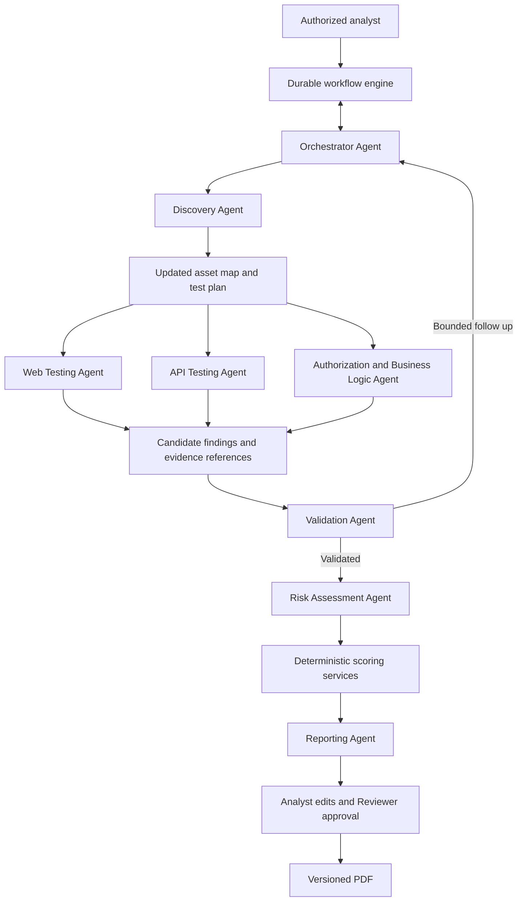
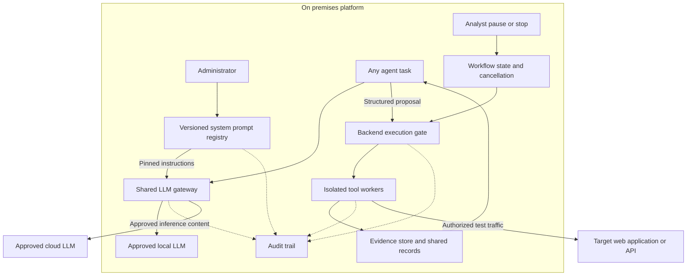

# AI Penetration Testing Platform Functional Requirements Document

Version 1.2 | 5 November 2026 | MVP requirements baseline for review

Audience: Engineering, security analysts, designers, QA, and acceptance reviewers.

Revision 1.1 expands finding-based retesting and adds Administrator-only system prompt management for each agent and configured LLM profile. User prompts and runtime task inputs are outside this management feature. Existing requirement IDs remain stable.

Revision 1.2 adds section 5.1 defining the multi-agent architecture, agent contracts, workflow authority, handoffs, execution boundaries, and diagrams. Existing requirement IDs remain stable; FR-AGENT requirements extend the baseline.

## 1 Purpose and conventions

This document specifies the behavior of an on-premises AI-assisted platform for authorized external black-box testing of web applications and exposed HTTP APIs. It implements PRD-01 through PRD-09. Quality targets, timing budgets, security properties, and operational verification are defined in the NFRD.

All numbered FR requirements are mandatory for the MVP unless explicitly identified as a future extension. Acceptance criteria describe required tests, not tests already executed. Numerical policy values identified as proposed in the NFRD require review under DEC-01 through DEC-07.

An engagement contains scope, authorization, context, assessments, and one or more runs. A run is one execution attempt. A task is a bounded unit assigned to an agent or tool worker. An asset is an authorized target or target component. A finding is a versioned claim supported by evidence. A report is an immutable snapshot of reviewed results.

Black-box excludes source code, internal configuration, and internal network access. Additional account or specification inputs are explicitly labelled. Business context used for risk assessment does not imply implementation access and is not automatically passed to discovery agents.

## 2 Local authentication

**FR-AUTH-001 Account provisioning**

The platform shall support local username accounts and a controlled one-time bootstrap of the initial administrator. Administrators can create accounts and assign roles without a public signup service. No shared default password may ship.

Acceptance: A fresh installation requires unique administrator setup; bootstrap cannot be reused. A newly provisioned user must set a password and enroll TOTP before normal access.

**FR-AUTH-002 Password and TOTP login**

The platform shall require a valid username and password followed by a valid TOTP before establishing a full session. The intermediate challenge is short-lived and grants access only to authentication completion or enrollment.

Acceptance: Password-only, TOTP-only, expired challenges, and reused accepted TOTPs do not grant access. Anonymous users cannot access protected APIs, evidence, or reports.

**FR-AUTH-003 Enrollment and recovery**

The platform shall verify TOTP enrollment before activating it and issue single-use recovery codes. Recovery and factor replacement require the approved recovery process; a replacement secret invalidates the previous factor. Administrator-assisted recovery must force a restricted reset flow rather than expose the secret.

Acceptance: An unverified enrollment does not activate MFA. A consumed recovery code fails on reuse. Reset and recovery actions are attributable, and lost-factor recovery never creates an unrestricted password-only session.

**FR-AUTH-004 Browser sessions**

The backend shall manage server-side browser sessions using secure HTTP-only cookies. It shall support expiry, logout, revocation, session rotation after authentication, and CSRF protection for state changes. Session secrets are not returned to JavaScript storage.

Acceptance: Expired or revoked sessions are rejected on subsequent requests. Logout invalidates the server-side session. Missing or invalid CSRF protection rejects cookie-authenticated mutations.

**FR-AUTH-005 Login controls**

The platform shall enforce configurable throttling for password and TOTP attempts, generic failure messages, and audit records for authentication outcomes. It shall expose an actionable account-recovery path without leaking whether an arbitrary username exists.

Acceptance: Repeated invalid attempts trigger the configured limit. Logs contain neither passwords nor OTP values. The attempt and its outcome remain auditable.

**FR-AUTH-006 Account lifecycle**

Administrators shall be able to disable accounts and initiate controlled password or MFA recovery. Users can change their own password after reauthentication. Security-sensitive changes revoke affected sessions according to policy. Active runs retain the original initiating identity even if the account is later disabled.

Acceptance: A disabled user cannot log in or use existing sessions. Disabling an initiating account pauses its active runs pending an authorized analyst decision. Historical attribution remains resolvable.

## 3 Roles and resource access

**FR-ACCESS-001 Initial roles**

The platform shall implement Administrator, Analyst, Reviewer, and Viewer roles. Roles can be combined. A role assignment does not grant authorization to test an asset outside the engagement scope.

| Capability | Administrator | Analyst | Reviewer | Viewer |
| --- | --- | --- | --- | --- |
| Manage accounts and settings | Yes | No | No | No |
| Manage system prompts and releases | Yes | No | No | No |
| Create and configure engagements | With Analyst role | Yes | No | No |
| Start pause resume stop runs | With Analyst role | Yes | No | No |
| Retest selected findings | With Analyst role | Yes | No | No |
| Edit findings and override assessments | With Analyst role | Yes | With Analyst role | No |
| Review findings and approve reports | With Reviewer role | With Reviewer role | Yes | No |
| Read and download permitted results | Assigned access | Assigned access | Assigned access | Assigned access |
| Read audit explorer | Authorized administrative scope | No by default | Assigned review scope | No by default |

Acceptance: Each matrix operation succeeds only for the listed role combination and assigned resource access. A single user may hold Analyst and Reviewer roles; two-person approval is optional policy.

**FR-ACCESS-002 Backend authorization**

The backend shall check authenticated identity, assigned project or engagement access, and action permission for every protected operation. Evidence storage and report downloads must not bypass these checks. Platform service identities have explicit, restricted permissions.

Acceptance: Changing a resource identifier cannot expose another project. Direct requests cannot bypass hidden UI controls. Worker credentials cannot manage users, permissions, or model endpoints.

## 4 Engagement configuration and readiness

**FR-ENG-001 Engagement record**

An analyst shall configure the engagement name, owner, targets, exclusions, testing window, authorization reference, access profile, model profile, execution budgets, prohibited actions, and business context. The platform shall retain versions of these settings.

Acceptance: Missing required fields are identified before run creation. Settings used by a run can be reconstructed after later engagement edits.

**FR-ENG-002 Authorization and scope**

The platform shall record the authorizing party and approved rules of engagement, verify target control or authorized delegation through an approved process, and enforce normalized target and exclusion rules. Discovered domains, redirects, shared hosting addresses, and related assets are not automatically authorized.

Acceptance: Out-of-scope destinations are blocked and recorded. Re-resolution or redirection cannot bypass scope checks. Revoking authorization blocks new work and initiates controlled run stoppage.

**FR-ENG-003 Readiness checks**

Before a run starts, the platform shall check authorization validity, testing window, target scope, risk-policy readiness, selected model compatibility, worker availability, storage, and required audit persistence. Missing business context may permit technical testing while clearly marking business risk provisional.

Acceptance: An execution-blocking failure prevents start and identifies the cause. A warning cannot silently become a complete business-risk assessment. Start remains disabled until mandatory gates pass.

**FR-ENG-004 Plan generation**

The orchestrator shall select applicable scenarios from the approved catalogue based on discovered features, access, scope, and permitted side effects. It shall record test prerequisites, dependencies, resource locks, budgets, and reasons for skipped scenarios. PTES provides an organizing reference for the engagement lifecycle, with NIST SP 800-115 informing assessment planning and limitations.

Acceptance: Plan entries reference valid catalogue versions. An agent cannot add an executable scenario outside the approved catalogue or change scope. Ordinary actions already covered by the execution profile do not require repeated user approval.

## 5 Run orchestration and execution controls

**FR-RUN-001 Run lifecycle**

The backend shall persist run state independently of agent conversation memory. Execution states are QUEUED, RUNNING, PAUSING, PAUSED, STOPPING, STOPPED, COMPLETED, and FAILED. The engagement can be READY without an active run. State changes are atomic and versioned.

| Current state | Permitted transition | Condition |
| --- | --- | --- |
| QUEUED | RUNNING or STOPPING | Readiness passes or an authorized stop is requested. |
| RUNNING | PAUSING STOPPING COMPLETED or FAILED | Control request, all work completed, or terminal failure. |
| PAUSING | PAUSED STOPPING or FAILED | All workers reach checkpoints, stop supersedes pause, or control cannot be completed safely. |
| PAUSED | RUNNING or STOPPING | Resume readiness passes or stop is requested. |
| STOPPING | STOPPED or FAILED | Execution termination is confirmed or control termination fails. |
| STOPPED COMPLETED FAILED | No resume | A linked new run is needed for further execution. |

Acceptance: Duplicate commands are idempotent. Concurrent pause and stop resolve in favor of stop. UI state matches the persisted state and worker confirmation.

**FR-RUN-002 Task assignment and parallelism**

The orchestrator shall coordinate discovery, specialist testing, validation, risk assessment, and reporting tasks. Independent tasks can run in parallel. Shared accounts, workflow objects, target budgets, and state-changing resources use coordinated limits and locks.

Acceptance: Independent target tasks overlap in a controlled fixture. Conflicting tasks serialize. The shared target budget is enforced across all agents rather than multiplied by worker count.

**FR-RUN-003 Pause**

An authorized analyst shall be able to request pause. The backend immediately prevents new task dispatch, signals workers, and waits for safe bounded checkpoints. Workers preserve task progress and evidence. PAUSED is set only when testing activity has quiesced.

Acceptance: The UI shows PAUSING until acknowledgments arrive. A worker that cannot reach a checkpoint within the approved deadline is canceled. Unconfirmed activity is never represented as PAUSED.

**FR-RUN-004 Resume**

Resume shall recheck authorization, testing window, scope, account state, model availability, and evidence of interrupted side effects. Eligible unfinished tasks continue from durable checkpoints. Interrupted state-changing tasks require explicit reconciliation before retry.

Acceptance: A valid paused run continues without repeating completed tasks. An expired window or revoked scope prevents resume. A possibly completed purchase or refund is not automatically submitted again.

**FR-RUN-005 Stop**

Stop shall prevent further task dispatch, cancel queued tasks, signal active tools and model requests, and terminate unresponsive workers after the configured grace period. Late model responses cannot schedule work. STOPPED requires confirmed execution termination; authorized bounded cleanup may precede finalization.

Acceptance: The UI shows STOPPING while termination is pending. A stopped run cannot resume. Already transmitted requests and target-side effects are disclosed as irreversible by the stop command. Failure to confirm termination raises an actionable failure and alert.

**FR-RUN-006 Interruptions and failures**

The system shall detect worker loss, model unavailability, budget exhaustion, and execution-window expiry. It shall preserve completed results, stop new prohibited work, and expose the reason. A recoverable model outage leads to a controlled pause; a lost worker is not assumed safe until its execution authority expires or termination is confirmed.

Acceptance: Restarting services does not lose recorded tasks or repeat side effects blindly. Expired budgets stop additional activity. Users can distinguish a test failure from a confirmed target weakness.

**FR-RUN-007 Cleanup and completion**

Tests shall record temporary accounts, files, sessions, and other artifacts requiring cleanup. Cleanup shall be bounded, authorized, and attributable. A run can complete only when tasks have terminal outcomes and remaining cleanup obligations are explicitly recorded.

Acceptance: Stop or completion preserves a cleanup checklist. Cleanup failures are visible in the engagement and report. Temporary evidence is not deleted before durable capture and authorized retention decisions.

### 5.1 Multi agent architecture and contracts

This section makes the agent design mandatory. Diagram arrows describe logical work and data flow; the durable workflow engine schedules every executable task. An agent role is a separate instruction set and task context, not a requirement for a separate server or unique underlying model. All roles execute on-premises and use the shared LLM gateway. Only approved inference traffic may reach a cloud model.

**FR-AGENT-001 Orchestration and authoritative execution**

The AI Orchestrator shall propose plans, assignments, dependencies, and follow-up investigations. The backend workflow engine shall own durable task state, dispatch, execution authority, retries, budgets, locks, cancellation, and run-state transitions. Agents cannot authorize their own actions or independently spawn executable work outside the engine. User pause and stop commands do not depend on an LLM response.

Acceptance: An orchestrator proposal creates work only after backend validation and persistence. A model attempting to bypass a paused run, expand scope, or dispatch directly is rejected and audited. Restarting the orchestrator preserves authoritative task state.

**FR-AGENT-002 Named roles and contracts**

The platform shall provide the following logical roles with explicit inputs, structured outputs, and permitted proposals. Inputs are restricted to the task's authorized context and referenced records. All testing actions remain subject to the execution gate in FR-AGENT-005.

| Agent role | Inputs | Structured outputs | Permitted proposals |
| --- | --- | --- | --- |
| Orchestrator | Approved scope, catalogue, run state, asset map, task results. | Task plan, dependencies, assignment, budgets, follow-up reasons. | Schedule eligible roles and revise the plan within authorization. |
| Discovery | Approved seed targets, access profile, bounded discovery tasks. | Pages, endpoints, methods, parameters, services, workflow map. | Approved browser, HTTP, or separately scoped service discovery. |
| Web Testing | Relevant pages, parameters, access context, selected web scenarios. | Candidate findings, expected and actual behavior, evidence references. | Catalogue-based web checks through tool adapters. |
| API Testing | Observed API endpoints, allowed methods, schemas if supplied, test identities. | API candidates, request-level evidence, coverage outcomes. | Catalogue-based API checks through tool adapters. |
| Authorization and Business Logic | Role and ownership context, workflow states, approved or inferred rules. | Access or flow candidates, rule provenance, uncertainty, evidence. | Bounded cross-account and workflow checks with suitable prerequisites. |
| Validation | Candidate revision, baseline behavior, raw evidence references, scenario criteria. | VALIDATED, REJECTED, or INCONCLUSIVE verdict; rationale and duplicate links. | Evidence inspection and bounded reproduction or follow-up requests. |
| Risk Assessment | Validated finding, demonstrated impact, business context, approved risk policy. | Proposed CVSS metrics, likelihood and impact, rationale, missing information. | Request deterministic calculation and flag assumptions for user review. |
| Reporting | Reviewed findings, calculated assessments, overrides, coverage, retest records. | Evidence-linked report draft and completeness issues. | Assemble and flag gaps; never approve its own final report. |

Acceptance: Each task records its role and satisfies the role's input and output schema. The same model can serve several roles while each has its own context and assigned system prompt. Missing credentials, workflow rules, evidence, or business context remain explicit limitations. Web and API roles avoid duplicate execution through scenario ownership and shared task keys.

**FR-AGENT-003 Handoffs and validation feedback**

Discovery results shall update the asset map and trigger eligible test selection. Independent specialist tests may proceed as soon as their prerequisites are available. Candidate findings go to Validation before scoring or confirmed report inclusion. Validation may request a specific, bounded follow-up through the Orchestrator; it must explain the evidence gap. Only validated findings proceed to confirmed assessment, and final report issue requires Reviewer approval.

Acceptance: A fixture follows discovery, specialist testing, validation, scoring, drafting, and review with linked records. A failed validation returns a reasoned follow-up or terminal rejected or inconclusive verdict. Configure task, iteration, request, and model budgets so feedback loops terminate with a visible unresolved outcome rather than continuing indefinitely.

Figure 1 shows the logical agent workflow. Independent branches share budgets and locks; they do not directly call one another to execute tests.

**FR-AGENT-004 Task context and shared records**

Each task shall have an isolated context containing task ID, role, actor chain, engagement and run IDs, authorized asset and scenario references, input-record revisions, access-profile references, dependencies, budgets, deadline, expected output schema, permitted adapters, and the pinned system prompt release and model profile. Credentials are resolved by trusted services through secret references, not copied into shared agent messages.

Agents shall exchange validated structured records and evidence references through a run-scoped workspace rather than relying on conversation memory. Task results include status, observations, output-record IDs, evidence IDs, limitations, cleanup obligations, and proposed follow-ups. All records retain provenance from engagement through run, task, tool or model execution, evidence, finding, assessment, and report.

Acceptance: One task cannot read an unrelated engagement or overwrite another task's inputs. Concurrent results preserve revisions. Restart and resume reconstruct context from durable records. Stale, malformed, or untraceable outputs cannot silently change a reviewed finding.

**FR-AGENT-005 Controlled tools and model access**

Every role shall use the shared LLM gateway with its pinned system instructions and approved model profile. Any proposed target action shall pass a backend execution gate checking current authorization, target scope, run state, scenario applicability, actor permissions, resource locks, and shared budgets. Only isolated tool workers execute approved actions. Workers capture evidence independently of agent narrative. No agent receives unrestricted shell, raw provider credentials, or a direct route to target execution.

Acceptance: Web, API, business-logic, discovery, and validation reproduction tasks all use the same enforced gate. Denied proposals do not execute. The Risk Assessment role cannot directly set calculated scores, and Reporting cannot fabricate evidence or mark an unreviewed draft approved. Audit events correlate proposal, decision, execution, evidence, and outcome.

Figure 2 shows shared services and trust boundaries. Target traffic and optional cloud inference use separate outbound policies. Audit capture spans all model, gate, worker, and administrative activity.

**FR-AGENT-006 Concurrency and resource ownership**

The engine shall coordinate per-target traffic budgets, per-identity sessions, and locks for state-changing workflow resources across all roles. The Orchestrator may split independent assets or scenarios into separate tasks, but global limits remain authoritative. A candidate or scenario ownership key prevents redundant testing while allowing evidence from distinct roles to be linked.

Acceptance: Unrelated endpoint checks run concurrently. Password changes on the same account and conflicting operations on the same transaction serialize. Duplicate task delivery does not cause duplicate state-changing actions, and aggregate traffic remains within the engagement limits.

**FR-AGENT-007 Lifecycle failures and bounded reasoning**

Agent tasks shall honor workflow cancellation and bounded retries. Invalid output, refusal, missing prerequisites, model outage, worker failure, or exhausted reasoning budgets shall produce explicit task outcomes, with the run handling required by FR-RUN. Paused or stopped tasks cannot dispatch follow-ups, and late results cannot revive execution. Cleanup follows the recorded, bounded obligations.

Acceptance: Cancellation, timeouts, repeated invalid outputs, and feedback-budget exhaustion preserve evidence and expose unresolved coverage. A recoverable model outage causes the defined controlled pause. Agent failure never becomes a passing test or a confirmed vulnerability by itself.

**FR-AGENT-008 Finding based retest routing**

A selected-finding retest shall create linked tasks using the original finding revision and reproduction criteria. The Orchestrator assigns only relevant specialist roles and necessary bounded prerequisite discovery, then routes new evidence through Validation and any required reassessment. Record differences in scenario, tool, model, and system prompt versions. Reporting uses the resulting reviewed retest records to create a new report snapshot.

Acceptance: Retesting an invoice ownership defect routes to authorization testing and validation without launching the full web and API catalogue. Interrupted or inconclusive attempts preserve prior validated disposition. Original evidence, overrides, and issued reports remain unchanged.

## 6 Testing catalogue and tools

**FR-TEST-001 Versioned scenarios**

Each executable scenario shall include an internal ID, version, framework references, applicability, prerequisites, expected secure behavior, permitted techniques, evidence requirements, validation procedure, side effects, and cleanup. WSTG supplies web test methods; ASVS supplies relevant control requirements.

Acceptance: A run pins catalogue and framework versions. Invalid references or missing execution controls prevent scenario activation. MASVS and MASTG remain future mobile references, not completed MVP coverage.

**FR-TEST-002 Standard tool adapters**

Workers shall expose structured adapters for ZAP, Playwright, reviewed Nuclei templates, a controlled HTTP client, and separately authorized limited Nmap discovery. Adapters validate parameters, capture tool and template versions, apply timeouts, and return normalized results and evidence references.

Acceptance: An agent cannot submit arbitrary shell text, install a tool, or enable an unreviewed template. Tool output is retained without becoming a confirmed finding automatically. Catalogue updates do not alter an active run.

**FR-TEST-003 Web and API discovery**

Discovery shall record reachable pages, HTTP endpoints, methods, parameters, observed authentication behavior, and workflow relationships within scope. API descriptions or test credentials supplied by the customer shall be labelled as inputs. Self-registration requires authorization and side-effect tracking.

Acceptance: Discovered but unauthorized assets remain untested. Distinct test identities use isolated sessions. A report identifies whether the run was anonymous, used self-registered accounts, or used supplied access or specifications.

**FR-TEST-004 Business flow hypotheses**

Business-flow tests shall record actors, states, transitions, preconditions, and rules with an observed, inferred, or customer-confirmed source. The MVP shall support curated skipped-step, repeated-action, and cross-account scenarios when prerequisites exist.

Acceptance: A suspected violation of an unconfirmed inferred rule is marked provisional or inconclusive. Live financial effects or destructive actions cannot run under the default profile. Lack of suitable accounts is reported as a coverage limit.

**FR-TEST-005 Coverage tracking**

For each scenario and target combination, the platform shall distinguish NOT_TESTED, NOT_APPLICABLE, INCONCLUSIVE, TESTED_NO_ISSUE_OBSERVED, and TESTED_ISSUE_CONFIRMED. Statuses include reasons and supporting task references.

Acceptance: Tool failure produces inconclusive or not tested, not a passing result. No findings does not imply full control verification. Coverage denominators disclose excluded and untested scenarios.

## 7 Findings and evidence

**FR-FIND-001 Candidate lifecycle**

Tool and agent observations shall enter as candidates. Validation assigns VALIDATED, REJECTED, or INCONCLUSIVE with reasons. Validated findings progress through REVIEWED and REPORTED; retest state is tracked separately.

Acceptance: A reporting agent cannot promote unsupported text into a confirmed finding. Reviewer changes retain previous verdicts and rationale. Confidence is separate from severity.

**FR-FIND-002 Validation and deduplication**

Validation shall compare expected and actual behavior, review evidence, reproduce where appropriate, consider alternative explanations, and consolidate duplicates by underlying issue and affected asset context. Dangerous reproduction is not required merely to demonstrate the maximum conceivable impact.

Acceptance: Known false-positive fixtures are rejected. Merged findings retain original evidence and affected assets. Inferred potential impact is identified separately from demonstrated impact.

**FR-FIND-003 Evidence capture**

The platform shall capture relevant request and response excerpts, screenshots, timestamps, test identity context, execution IDs, tool versions, and artifact hashes. Restricted raw evidence and redacted report evidence are stored separately with access checks.

Acceptance: Every confirmed claim links to adequate evidence. An authorized reviewer can trace it to a run and task. A screenshot alone cannot satisfy a scenario requiring request-level proof. Missing or corrupted evidence blocks confirmation or report approval as appropriate.

**FR-FIND-004 Finding editing**

Authorized analysts shall edit titles, descriptions, assets, prerequisites, expected and actual behavior, reproduction steps, impact, remediation, framework mappings, and assessment rationale. Changes retain author, timestamp, reason where required, and prior values.

Acceptance: Concurrent edits use version checks and expose conflicts. Edits cannot silently alter raw evidence. Remediation advice is checked against the observed issue and is labelled generic when implementation access is unavailable.

**FR-FIND-005 Retesting**

An analyst shall initiate a scoped retest of one finding or selected findings after remediation. The system shall create a linked retest run using the original findings, evidence references, and reproduction criteria as its baseline. Outcomes per finding are FIXED, PARTIALLY_FIXED, STILL_OPEN, or INCONCLUSIVE. No full assessment is required.

Acceptance: Selecting one finding runs only its applicable checks and necessary bounded prerequisites. Batch selection retains an outcome per finding. Original evidence remains unchanged; unavailability, interruption, or an inconclusive attempt never becomes fixed. New evidence and report versions retain links to the original findings.

**FR-FIND-006 Retest readiness and controls**

Before executing a retest, the platform shall recheck current authorization, approved assets, testing window, required test identities, budgets, and the applicability of original reproduction criteria. The retest plan shall identify any necessary prerequisite discovery and changes in scenario, tool, model, or system prompt release versions. Retest runs use the standard pause, resume, stop, cleanup, and audit behavior.

Acceptance: Expired authorization or an excluded endpoint prevents execution. Unsupported original test versions or changed prerequisites produce an explicit plan adjustment or inconclusive result, not a silent replacement. Stopping a retest preserves completed attempts and pending or interrupted outcomes without changing the original run.

**FR-FIND-007 Retest history and disposition**

Each attempt shall record selected finding revisions, remediation notes, actor, timestamps, baseline criteria, configuration and version differences, new evidence, outcome, and validation rationale. The finding view shall show original and retest evidence together and maintain the latest validated disposition separately from original technical severity and manual assessment history.

Acceptance: Repeated attempts remain individually accessible. A missing page or changed response alone cannot establish that the security control is fixed. Only a validated retest updates the finding disposition; an inconclusive attempt preserves the prior validated disposition and exposes the latest attempt status. Review and report versions show the before-and-after result.

## 8 Technical severity and business risk

**FR-SCORE-001 CVSS 4 calculation**

The platform shall record CVSS 4.0 metric selections, evidence-linked reasoning, vector, calculated score, rating, nomenclature, and calculator version. A deterministic service validates and calculates scores; agents only propose inputs. Optional Threat and Environmental selections must be explicit. Supplemental metrics do not change the numeric score.

Acceptance: Approved reference cases match FIRST calculations. Invalid vectors fail validation. CVSS 3.1 values are not relabelled as 4.0. Missing metric justification leaves the assessment provisional. Findings unsuitable for CVSS explain why instead of receiving an invented score.

**FR-SCORE-002 Business risk policy**

The platform shall support a versioned customer-approved 5 by 5 likelihood and impact policy. Each assessment states the business scenario, horizon, criteria, likelihood, impact, resulting band, existing controls, assumptions, and risk owner. Missing context is explicit.

Acceptance: Only approved policies produce finalized business ratings. Every matrix cell maps to the configured policy. Changing a policy creates a version and does not rewrite previous reports. CVSS is not automatically converted into business likelihood or impact.

Proposed policy values for review under DEC-03 are shown below. They are not prescribed by ISO 31000.

| Likelihood and impact | 1 | 2 | 3 | 4 | 5 |
| --- | --- | --- | --- | --- | --- |
| 5 Almost certain | 5 | 10 | 15 | 20 | 25 |
| 4 Likely | 4 | 8 | 12 | 16 | 20 |
| 3 Possible | 3 | 6 | 9 | 12 | 15 |
| 2 Unlikely | 2 | 4 | 6 | 8 | 10 |
| 1 Rare | 1 | 2 | 3 | 4 | 5 |

Illustrative bands are 1 to 4 Low, 5 to 9 Moderate, 10 to 16 High, and 17 to 25 Extreme. Define likelihood over an approved horizon, initially proposed as 12 months, with customer-agreed anchors. Define impact across financial loss, service interruption, privacy, regulatory consequences, reputation, and safety. A proposed aggregation uses the highest applicable consequence, with explicit severe-consequence overrides. These ordinal values are prioritization aids, not exact probabilities or financial estimates.

**FR-SCORE-003 Manual assessment changes**

Analysts shall be able to edit CVSS metrics and recalculate, override the reported severity with a mandatory reason, and edit business likelihood and impact with rationale. The original platform assessment, current calculated assessment, and effective manual decision remain distinguishable.

Acceptance: An arbitrary manual number cannot be represented as a calculated CVSS score. Overrides show actor, reason, timestamp, and before-and-after values. Restoring the platform assessment is itself an audited revision.

**FR-SCORE-004 Reassessment**

New evidence or model output shall create a proposed assessment revision and must not overwrite an existing manual decision. The platform shall flag a manual decision for review when its evidence or scoring basis changes.

Acceptance: Regeneration preserves overrides. A stale decision is visible in the review queue. Report approval requires acknowledgment or resolution of material assessment changes.

**FR-SCORE-005 Treatment records**

The platform shall record recommended priority, risk owner, selected treatment, target date, review date, and any documented acceptance decision. AI can recommend treatment; accountable users make acceptance decisions.

Acceptance: A business-risk score can be traced to its scenario and policy. Risk acceptance includes a responsible user and rationale. Proposed residual risk is not represented as verified until supported by retesting or other evidence.

## 9 Model gateway

**FR-LLM-001 Endpoint profiles**

Administrators shall configure local and approved cloud profiles using base URL, model identifier, secret reference, timeouts, usage limits, data boundary, and required capabilities. Every agent shall use the internal gateway. The MVP portability baseline is the OpenAI-compatible Chat Completions request and response shape.

Acceptance: A local and a cloud endpoint pass the same agent-facing contract suite. Browser code never receives provider credentials. Worker or target content cannot alter model profiles.

**FR-LLM-002 Compatibility and structured outputs**

The gateway shall check the capabilities required by each agent role, normalize responses and errors, and validate structured outputs before use. Unsupported options are not sent blindly. A profile that cannot reliably satisfy an assigned role is rejected or restricted to supported roles.

Acceptance: Invalid JSON, schema violations, unsupported tool calls, refusals, timeouts, and truncated outputs are handled without tool execution. A model-proposed action still passes backend policy and scope checks.

**FR-LLM-003 Data routing and availability**

Cloud inference shall receive only content permitted by the configured outbound-data policy after applicable redaction. Endpoint selection is explicit. No automatic local-to-cloud fallback is allowed. Unavailable inference pauses dependent execution without discarding completed work.

Acceptance: Restricted secrets and denied evidence classes do not leave the premises. Network tests show no unapproved provider traffic. Late or canceled responses cannot launch tools or mutate a stopped or paused run.

**FR-LLM-004 Model provenance**

Each model request shall record the initiating identity chain, agent role, run and task, profile, model, system prompt version and content hash, system prompt release ID, duration, outcome, and available usage. Relevant runtime input and output artifacts are retained only under evidence policy with restricted access and redaction; they are not system prompt versions.

Acceptance: A finding can be traced to the model execution that proposed it. Audit logs exclude raw secrets and unrestricted prompt content. Store concise decision rationales, not a requirement for private model reasoning traces.

### 9.1 Administrator system prompt management

**FR-PROMPT-001 Restricted system prompt library**

The platform shall provide an on-premises library of system instructions assigned to each agent role and approved LLM profile. Only users with the Administrator role may access system prompt bodies or create, edit, validate, publish, assign, activate, roll back, retire, or delete eligible drafts. Each system prompt records a stable key, purpose, agent role, permitted model-profile assignments, optional trusted configuration-variable contract, output-contract reference, version, author, timestamps, change reason, and content hash. Other authorized users may see version metadata required for execution provenance.

Acceptance: Analyst, Reviewer, Viewer, agent, and worker identities cannot manage or retrieve system prompt bodies through the UI, direct API, or storage access. Administrator actions retain audit attribution. System prompts contain no embedded credentials. The gateway execution service may resolve pinned bodies solely for inference under a separate read-only identity. User prompts, target data, evidence, and task inputs are separate runtime messages or context and cannot update this library.

**FR-PROMPT-002 Drafts and immutable versions**

Administrators shall create and edit system prompt drafts, compare versions, and save a required change reason. Publication creates an immutable version from a validated draft. Editing a published version creates a new draft; it never changes published content. Referenced published versions remain available for historical resolution and cannot be hard-deleted. Editing a user or task message does not create or modify a system prompt version.

Acceptance: Version comparison shows the changes and author. A published version's content and hash cannot change. Draft deletion is allowed only when it does not remove published provenance and is audited. Retiring a version prevents new release selection but does not erase execution history.

**FR-PROMPT-003 Validation and evaluation**

Before publication or release activation, the platform shall validate any declared trusted configuration variables, safe rendering, agent and output-contract compatibility, instruction-role separation, and controlled evaluation fixtures for assigned LLM profiles. Model-assisted evaluations use the selected approved profile and synthetic or separately authorized data. System prompts cannot execute code, redefine tool schemas, or bypass backend authorization, scope, data routing, deterministic scoring, and run controls.

Acceptance: Missing variables, unsafe expressions, invalid expected output, unsupported instruction-role handling, or failed required fixtures block publication or activation. Evaluation never launches target tests. Results record model and system prompt versions and are visible to the Administrator. A backend policy remains enforceable even when a system prompt attempts to contradict it.

**FR-PROMPT-004 Release activation and rollback**

A system prompt release shall contain an immutable manifest mapping each required agent role and configured LLM profile to a published system prompt version. Reuse of a compatible version across profiles is allowed. Administrators shall activate a complete validated release atomically and may roll back by activating an eligible prior release after compatibility checks. The platform shall retain release history, activation time, actor, and reason. An active version cannot be retired without an eligible replacement release.

Acceptance: Incomplete or incompatible manifests cannot activate. Concurrent updates use version checks. New executions select exactly one active release; activation cannot mix old and new template sets. Rollback is a new audited activation and does not rewrite prior history.

**FR-PROMPT-005 Execution pinning**

At creation of a run or an independent report-drafting job, the platform shall snapshot the selected system prompt release and resolve the agent and LLM profile assignment by immutable version and hash. The gateway shall supply these instructions through the provider's supported system-instruction mechanism and keep user messages, evidence, and tool outputs in their separate runtime context. In-flight tasks, retries, and resumed runs retain that release. A retest is a new linked run and snapshots the current eligible release, recording differences from the original. Emergency replacement of an active run's system prompts requires ending that execution and starting a linked new run.

Acceptance: Editing or activating system prompts does not change running or paused assessments. A missing or corrupt pinned version blocks dependent work rather than substituting current text. Every model request resolves to the pinned manifest. User or target content cannot replace the resolved system instructions. Export from an approved report snapshot uses stored content without new inference.

## 10 Audit trail

**FR-AUDIT-001 Event schema**

Each event shall include a unique event ID, occurrence and recording timestamps in UTC, actor type and ID, action, affected platform resource, affected asset references where applicable, engagement and run IDs where applicable, outcome, correlation ID, and sanitized changes or reason. Agent and service events also record the initiating user and parent execution when available.

Acceptance: Actor types distinguish user, agent, service, worker, and unauthenticated attempt. Target asset and affected platform object are separate. Historical identity is retained after account disablement.

**FR-AUDIT-002 Activity coverage**

The platform shall audit authentication, access denials, meaningful resource reads and searches, evidence access, downloads, configuration and permission changes, engagement actions, task and tool lifecycle, model-call lifecycle, findings, scoring overrides, cleanup, reports, retest selection and outcomes, and system prompt management. System prompt events cover draft changes, comparisons and body access, validation results, publication, agent and LLM assignment, activation, rollback, retirement, eligible deletion, and denied attempts. High-volume target exchanges are traceable execution artifacts referenced from audit events.

Acceptance: An end-to-end fixture reconstructs who initiated, executed, changed, reviewed, and exported a result. Both control requests and confirmed outcomes are present. Technical health probes are classified separately and cannot disguise user actions.

**FR-AUDIT-003 Durable recording**

State mutations and required audit events shall commit together or through an equivalent durable transactional design. Privileged changes, scan starts, sensitive evidence access, and exports require durable audit recording. The platform shall expose delivery failures without silently dropping events.

Acceptance: Simulated audit failure blocks the protected action or retains a durable event before acknowledgment. Retry does not duplicate the logical action. Audit read and export actions are themselves logged.

**FR-AUDIT-004 Explorer and export**

Authorized users shall search and filter audit events by actor, action, resource, asset, engagement, time, outcome, and correlation. They shall export a permission-filtered structured record, such as JSON or CSV, with UTC timestamps and event IDs.

Acceptance: Restricted events remain inaccessible through filters or exports. Large results paginate. Exporting an event set produces its own audit event and preserves field meanings.

## 11 Reports

**FR-REPORT-001 Report structure**

The platform shall generate a PDF with document control, executive summary, scope and objectives, methodology and limitations, coverage, findings overview, detailed findings, remediation priorities, retest results, and appendices. Document control includes report ID, version, dates, author and reviewer identities, and confidentiality marking.

Acceptance: A completeness check verifies all sections. Retests not performed are explicitly labelled. A no-findings report still states coverage and limitations.

**FR-REPORT-002 Detailed findings**

Each finding shall include description, affected assets, prerequisites, evidence, expected versus actual behavior, ordered reproduction steps, demonstrated and supported potential impact, CVSS vector and rationale where applicable, business-risk assessment, manual overrides, remediation, references, status, and retest results when available. Retest reporting includes attempt dates, selected findings, original versus current validated disposition, new evidence, inconclusive or interrupted attempts, and material execution-version differences.

Acceptance: Every factual claim and reproduction step is supported by the finding record. Report evidence is redacted. Missing mandatory evidence or material review decisions block issue of a final report rather than being invented by the reporting agent.

**FR-REPORT-003 Review and versioning**

Reviewers shall approve a structured snapshot for final export. The PDF is generated from that snapshot and stored with its version and integrity hash. Preview PDFs are visibly labelled as previews. Later edits produce a new version without changing previously issued content.

Acceptance: A regenerated report from the same snapshot preserves substantive content. Concurrent edits cannot change an approved snapshot. Approval and every download are attributable.

**FR-REPORT-004 Partial assessments**

The platform shall allow reviewed partial reports for stopped, failed, or otherwise incomplete runs. They shall identify the termination reason, completed and interrupted tests, untested areas, confirmed findings, evidence limitations, and outstanding cleanup.

Acceptance: A stopped assessment is never labelled complete. Partial findings and coverage remain available after worker termination. Report status distinguishes preview, final complete assessment, and final partial assessment.

## 12 On premises operation and configuration

**FR-OPS-001 Installation boundary**

All application services, agents, testing workers, state, evidence, audit storage, and report generation shall run on-premises. Only approved inference traffic and engagement-required target traffic may leave under their separate policies. No hosted platform control plane or external identity service is required.

Acceptance: With a local model and reachable local test target, the full assessment and report flow works with external vendor access blocked. Cloud-model operation does not move platform services or storage off-premises.

**FR-OPS-002 Versioned configuration**

Administrators shall configure risk policies, model profiles, system prompt releases, catalogue versions, control timeouts, execution limits, retention, and session policy. Changes are audited. Runs retain their effective configuration snapshot; security revocations override previous authorization immediately through run control.

Acceptance: A reviewer can identify settings used for a historical result. An agent cannot modify administrative policies. Invalid or unapproved settings fail readiness checks.

**FR-OPS-003 Backup and recovery operations**

The installation shall support documented backup, restore, health inspection, and controlled upgrade procedures. Recovery reconciles workflow state, worker authority, evidence references, audit events, and report snapshots before execution resumes.

Acceptance: A restore drill recovers a consistent engagement and issued report. Interrupted tools are not automatically re-executed. Worker or audit health failures are visible to administrators.

## 13 Data and interface contracts

The recommended logical architecture is a protected web frontend, a modular backend, durable workflow state, isolated testing workers, an evidence store, and a local report worker. The orchestrator routes reasoning through the LLM gateway and tool actions through scope enforcement and adapters. Scoring is deterministic, and audit capture spans every module. These are responsibility boundaries; they do not require a separate deployed service for every module.

A suggested engineering baseline is a TypeScript frontend, Python backend and agents, PostgreSQL, S3-compatible local evidence storage, containerized workers, and an HTML-to-PDF renderer. The workflow implementation and exact frameworks are design choices that must satisfy the FRD and NFRD. No hosted workflow engine or identity provider is required.

The implementation shall maintain these logical records; physical tables and service boundaries are design choices.

| Record | Required relationships and content |
| --- | --- |
| User and role assignment | Local identity, password hash, protected TOTP material, account state, roles, and assigned access. |
| Session and authentication challenge | User, expiration, revocation, and restricted preauthentication state. |
| Engagement and authorization | Scope versions, rules, owner, approvals, access profile, and business context. |
| Run and task | Effective configuration, state, dependencies, worker authority, budgets, checkpoints, and cleanup. |
| Agent task context and result | Role, actor chain, versioned inputs, authorized references, prompt and model binding, output schema, budgets, task outcome, evidence references, and bounded follow-ups. |
| Scenario and tool execution | Catalogue and framework versions, adapter and template versions, inputs, outcomes, and artifact references. |
| Finding and evidence | Claim revisions, validation, affected assets, reproduction, restricted originals, redacted derivatives, and hashes. |
| Assessment revision | CVSS inputs and output, business policy and factors, confidence, manual decisions, and history. |
| Retest attempt | Selected finding revisions, linked run, baseline criteria, remediation context, evidence, version differences, validation, and disposition. |
| System prompt and version | Stable key, agent role, LLM profile assignments, trusted configuration-variable contract, output-contract reference, draft or published instructions, content hash, author, reason, and immutable version. |
| System prompt release and activation | Immutable agent and LLM assignment manifest, validation record, compatibility, activation or rollback history, and pinned execution references. |
| Report snapshot | Reviewed content, coverage, report status, reviewer, PDF artifact, version, and hash. |
| Audit event | Actor chain, action, affected object and asset, time, outcome, sanitized change, and correlation. |

Every mutation endpoint shall enforce action permission, input validation, object access, optimistic version checks where needed, and audit persistence. Run control commands shall accept idempotency identifiers. The server provides live state updates or bounded polling; UI indicators do not independently determine execution state.

## 14 Acceptance evidence register

QA shall record requirement ID, fixture, expected outcome, actual outcome, evidence location, environment, version, and reviewer. Required suites cover authentication and roles; scope and egress; lifecycle and failure injection; supported scenario ground truth; evidence integrity; scoring; finding-based retests; provider compatibility; system prompt access, role separation, agent and LLM assignment, publication, pinning and rollback; audit reconstruction; PDF output; and backup restoration. Multi-agent suites shall cover FR-AGENT-001 through FR-AGENT-008, including schema-valid handoffs, separate contexts, bounded feedback, shared budgets, duplicate delivery, denied execution, late responses, and retest routing. Product traceability is in PRD section 9; measurable targets are in the NFRD.

## 15 Technical reference register

References establish definitions and integration guidance. They do not imply certification, full test coverage, or unrestricted rights to redistribute standards. Pin the chosen framework, tool, and calculator versions in release records. Review licensing before bundling reference content or templates; link to licensed standards rather than embedding full text.

- FIRST CVSS 4.0 specification: https://www.first.org/cvss/v4.0/specification-document
- FIRST reference calculator: https://www.first.org/cvss/calculator/v4-0
- OWASP Web Security Testing Guide: https://wstg.owasp.org/
- OWASP Application Security Verification Standard: https://asvs.owasp.org/
- ISO 31000 risk management guidance: https://www.iso.org/standard/31000
- IEC 31010 risk assessment techniques: https://www.iso.org/standard/72140.html
- NIST SP 800-115 assessment guide: https://csrc.nist.gov/pubs/sp/800/115/final
- PTES engagement lifecycle documentation: https://pentest-standard.readthedocs.io/en/latest/
- OWASP password storage: https://cheatsheetseries.owasp.org/cheatsheets/Password_Storage_Cheat_Sheet.html
- OWASP multifactor authentication: https://cheatsheetseries.owasp.org/cheatsheets/Multifactor_Authentication_Cheat_Sheet.html
- OWASP session management: https://cheatsheetseries.owasp.org/cheatsheets/Session_Management_Cheat_Sheet.html
- OWASP logging: https://cheatsheetseries.owasp.org/cheatsheets/Logging_Cheat_Sheet.html
- OpenAI Chat Completions contract: https://developers.openai.com/api/reference/chat-completions/overview
- OpenAI structured outputs: https://developers.openai.com/api/docs/guides/structured-outputs?api-mode=chat
- ZAP Automation Framework: https://www.zaproxy.org/docs/automate/automation-framework/
- Nuclei execution documentation: https://docs.projectdiscovery.io/opensource/nuclei/running
- Playwright API and PDF generation: https://playwright.dev/docs/api/class-page#page-pdf
- Nmap introduction: https://nmap.org/book/intro.html
- Future mobile reference only OWASP MASTG: https://mas.owasp.org/MASTG/
